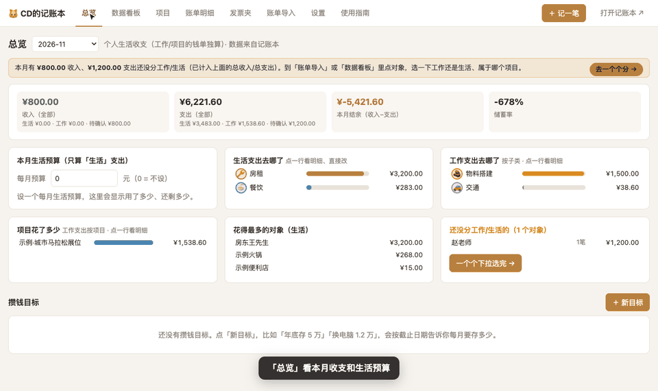
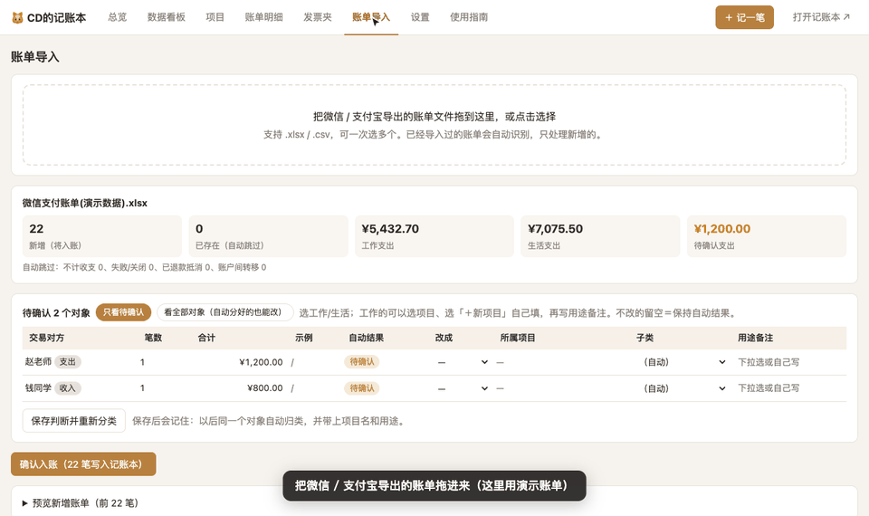
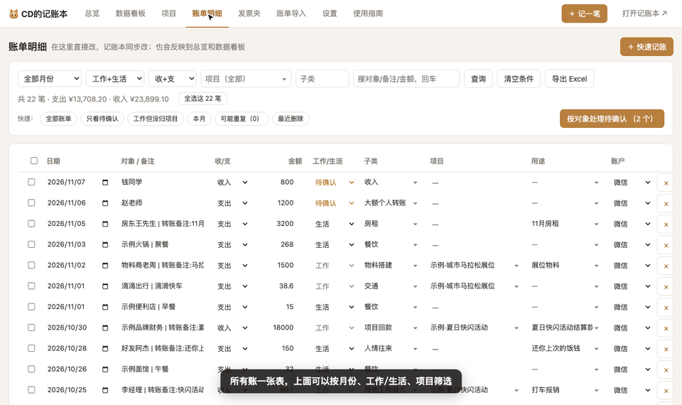
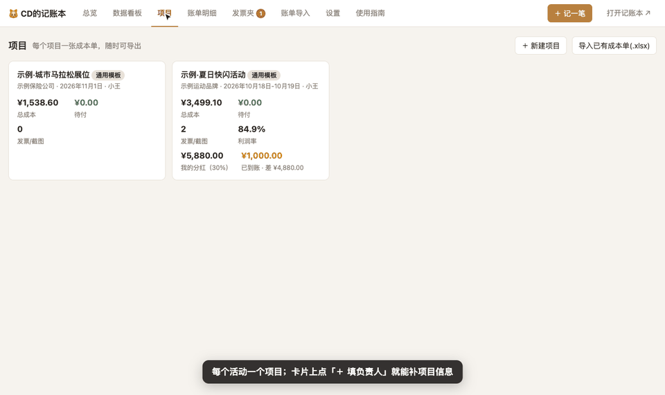
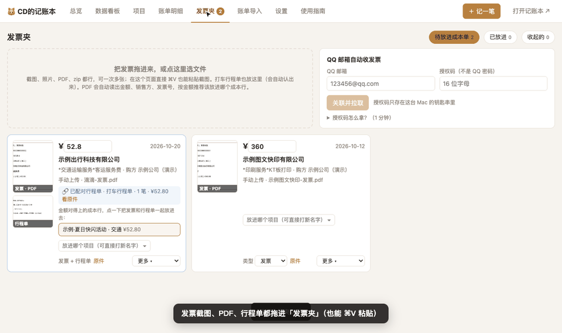
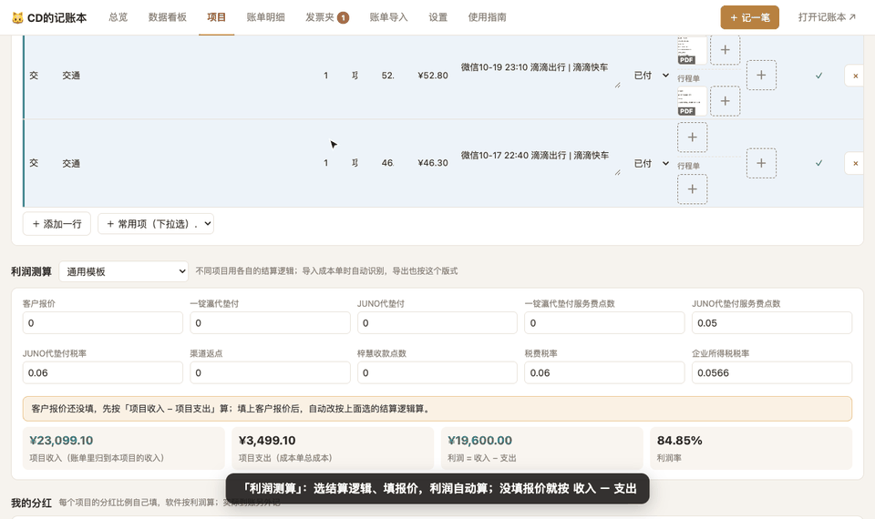
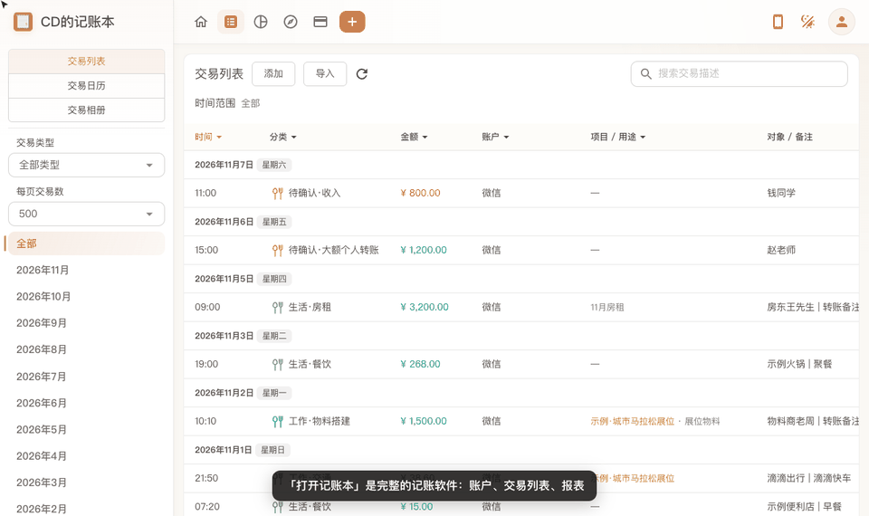
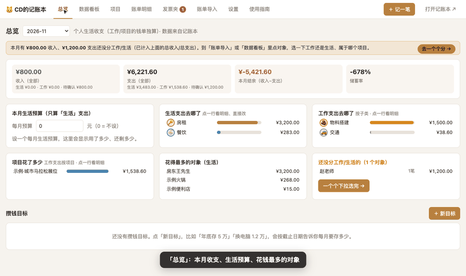
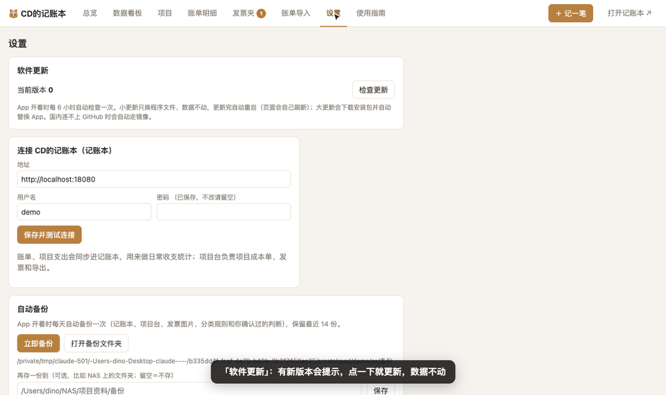

<h1 align="center">CD的记账本</h1>

个人账 + 项目成本单，一个 Mac 软件搞定 微信 / 支付宝账单拖进来自动分「工作 / 生活」，项目成本单、发票、行程单、报销单、利润和分红一起管

<a href="https://github.com/Dino12138/jizhangben-releases/releases/latest"><b>⬇️ 下载最新版</b></a>

> 🔒 **所有数据只存在你自己的电脑上，不上传任何地方。** 下面的动图都是用演示数据录的。

---

## 下载安装

1. 到 [Releases](https://github.com/Dino12138/jizhangben-releases/releases/latest) 下载最新的 `JiZhangBen-版本号.dmg`。
2. 双击打开，把「CD的记账本」拖进「应用程序」。
3. 第一次打开：在「应用程序」里**按住 control 点它 → 打开 → 打开**（没有付费签名，系统会拦一下；也可以在「系统设置 → 隐私与安全性」点「仍要打开」）。
4. 只支持 Apple 芯片（M1–M4），macOS 12 及以上。

打开后会自动在浏览器里打开「项目台」，不会用就点顶部 **「使用指南」**，每个功能都有演示视频。

## 更新

App 开着时每 6 小时自动检查，有新版本顶部会提示 → **设置 → 软件更新 → 立即更新**。
小更新只换程序（约 1 分钟，数据不动，自动重启）；大更新会下载新安装包并自动替换。国内连不上 GitHub 时自动走 jsDelivr 镜像，不用翻墙。

> 1.4.0 之前的版本没有在线更新，需要手动装一次最新版。

---

## 功能

### 📥 账单导入
微信 / 支付宝账单拖进来，自动分「工作 / 生活 / 待确认」。**你写的转账备注优先**：备注「XX活动打车」会归到对应项目、用途写「打车」；「备用金 / 报销」类收入不会算成项目回款。之前手记过的同一笔会自动合并，不重复。

### 📋 账单明细
所有账一张表，每一格直接改（工作/生活、子类、项目、用途），记账本和项目成本单同步更新；批量改、合并重复、最近删除（90 天可恢复）、导出 Excel。

### 📁 项目与成本单
每个活动一张内部成本单：归到项目的账单自动出现在成本单里；可以上传之前做好的成本单（自动合并、匹配账单）；每行可传 **发票 / 行程单 / 支付截图**，也能直接从邮箱里选；导出成本单 Excel（带公式、带高清发票图），或一键导出全部发票原件到你选的文件夹。

### 🧾 发票夹 / 行程单 / 报销申请单
发票截图、PDF 拖进来自动读金额、销售方、发票号；发票和行程单自动配对，一点放进对应成本行；关联 QQ 邮箱后自动收发票邮件。报销申请单上传后自动记备用金、配对成本行。

### 💰 利润与我的分红
按项目的结算逻辑算利润；分红比例自己填，自动算应得分红，实际到账另记，自动显示还差多少。

### 📒 记账本
完整的记账软件：账户、交易列表、统计报表。编辑一笔账时可以快速归类、直接上传发票 / 行程单。

### 📊 总览与数据看板
本月收支、生活预算、花钱最多的对象；12 个月趋势、分类占比、项目成本和利润、借款还款提醒。

### ⚙️ 设置、备份与更新
每天自动备份（可再存一份到 NAS），在线更新，更新后有问题可一键退回上一版。

---

## 数据在哪 / 卸载

- 数据：`~/Library/Application Support/CD的记账本/`（每天自动备份到其中的「备份」文件夹）
- 卸载：退出 App，删掉「应用程序」里的 CD的记账本；连数据一起删就再删上面的文件夹。

## 更新记录
- **1.6.0**（2026-11-11）：改成真正的 Mac 程序窗口：双击打开就是一个窗口，顶上「项目台 / 记账本」两个页签（⌘1 / ⌘2 切换），不再跳浏览器；导出 Excel、看发票原件、上传发票都在窗口里完成。同步联动：任何一边记账或改账，几秒内总览、我的钱、交易日历、待处理和记账本列表都会自动更新。记一笔、编辑一笔在保存前就显示各账户余额会怎么变，保存后再提示实际变化；编辑转账可以改转出账户和金额，转账说明文字始终和实际账户一致；账户卡片显示最近一笔。项目页新增「钱怎么走的」（每一方的名字、点数、税点都能改，和利润测算同步），利润测算逐项列出「怎么算的」并支持自定义公式；开出去的发票和成本单用同一套发票格（缩略图、从邮箱 / 发票夹选、拖拽、粘贴）。导入账单时品牌总称、付款平台不再自动乱归项目。导出文件、运行日志、临时文件自动清理，软件不会越用越大。这次需要完整更新一次（约 1 分钟，数据不动）。
- **1.5.0**（2026-11-10）：项目页新增「钱怎么走的」：甲方 → 中间方 → 执行方 → 我，每一方的名字、点数、税点都能直接改，和利润测算同步，并自动对比实际到账；开出去的发票可记开票方，自动挂到对应那段转款下。备用金可设置有一部分在助理手里：分别算出她手上还剩多少、还有多少没报销给你。我的分红新增「分红提成」（从自己那份里付给别人的提成），转账手续费造成的小差额可一键算结清。新增「项目报销」「分红转出」「项目款转出」三种子类，各个记账入口同步。导入账单时和手记重复的（含生活账）改为列出来让你确认；记账本里重复的分类自动合并；修复若干问题。
- **1.4.11**（2026-11-10）：记账本「添加交易」里直接有快速归类（项目、打车起点→终点、付款情况、借款/还款、发票），点添加一起保存；交通/出行类也显示打车路线；借款和还一部分可选币种；项目台收起的账户在记账本里也不显示。
- **1.4.10**（2026-11-10）：记账本「添加/编辑交易」：选账户时直接列出全部账户；金额下面可选币种，外币自动按汇率折算；修正零钱/支付宝/外币卡被误归为负债账户的问题。
- **1.4.9**（2026-11-10）：余额按时间算：录入余额时填「什么时候看的」，之后的账才加减；每笔账都有几点几分（没写就用记账时的当前时间）。外币账户（如美元卡）：选币种、汇率自动折算，账户可加备注；记一笔和编辑都能选币种。账户之间转账（如零钱充值美元卡）不算收支。撤回：改错了左下角一键撤回。借款 / 还款：两个编辑窗口都能直接借入、借出、还款，支持「还一部分」，账单同步补记。项目备用金入款单独显示、不算收入。我的钱：净资产 = 账户合计 + 公司欠我 + 待收分红 − 应退公司；收起的账户入口移到右上角。数据看板、总览每个数字都能点开看明细；记账本统计饼图点一下直接跳明细。修复：记一笔英文项目误识别（claude ≠ CLC）、行程单不显示、缩略图过大等。
- **1.4.8**（2026-11-09）：成本单表格排版修复：各格统一靠上对齐，发票 / 行程单 / 支付截图缩略图在同一高度，「＋」和「📧 从邮箱选」改成小按钮；付款情况完整显示（备用金垫付）；金额列靠右并和后一列留出间距。另含 1.4.7 全部内容。
- **1.4.7**（2026-11-09）：记账逻辑分成三本账：我的收入（生活+项目分红）/ 项目资金（备用金入款、报销、客户回款、工作支出）/ 待确认，不再混在一起；新增「我的钱」：账户余额录入、按支付方式自动分账户（零钱/零钱通/各银行卡）、公司的钱 / 公司欠我（垫付待报销）/ 待收分红 / 我的总资产，可删除账户；账单明细改成列表+点开编辑，带分类图标；记一笔按关键词自动分配、记住你的改法；打车可填起点终点，成本单按内部成本单写法（打车费｜日期｜名字 起点-终点）；借款 / 还款（借入、借出两个方向，一键「已还款」同步账单）；上传成本单后对不上的账单进「待核对」，备用金同一笔只算一次；编辑交易可从邮箱 / 发票夹选发票和行程单；TOP10 三张卡并排、选生活/工作自动移卡；若干排版修复。
- **1.4.6**（2026-11-09）：记一笔：按关键词自动分配项目、子类和用途，不加空格也能认（如「黄老师学校项目打车38.87」「沈阳物料打印 120 未付」），每行显示识别依据；分错了改一次，下次同样的写法自动照你的改法来。
- **1.4.5**（2026-11-09）：修复在线小更新报错（1.4.3 起无法小更新的问题），这次需要完整更新一次：点「下载并安装新版」，约 1–3 分钟，数据不动。包含 1.4.4 的全部内容：付款情况统一为成本单的 5 个选项、已付金额列、发票情况、其他备注。
- **1.4.4**（2026-11-09）：项目成本单和杭马内部成本单对齐：付款情况统一为「未付/预付/已付/备用金垫付/无需付款」（记一笔、账单明细、记账本快速归类都能选，改了同步到成本单）；成本单新增「已付金额」列、「发票情况」（如 待开，一锭瀛）、「其他备注」（如 待退回），导入导出都保留；修正导入成本单时已付金额和发票文字混进供应商信息。
- **1.4.3**（2026-11-09）：记一笔：工作项目的支出可以选「已付 / 待支付 / 备用金支付」，待支付的先记进成本单（未付），以后付了自动对上；修好在线更新（中文文件名）；导出成本单主表放高清原图、去掉附表；新增「导出发票原图」到你选的文件夹。
- **1.4.2**（2026-11-09）：导出成本单：主表直接放高清原图，去掉重复的附表（文件小一半）；新增「导出发票原图」：发票/行程单/支付截图原件一键导出到你选的文件夹；修正导出文件名金额。
- **1.4.1**（2026-11-09）：成本单「发票」「行程单」分成两列，每格可直接从邮箱/发票夹选票；项目页提示发票夹里对得上的票，一键放进；新增报销申请单导入（自动记备用金、配对成本行）；PDF 发票按 300dpi 高清保存；修好 App 图标。
- **1.4.0**（2026-11-09）：新增：使用指南（每个功能都有演示视频）、在线更新、发票夹（发票/行程单自动配对、QQ 邮箱自动收）、我的分红、上传已做好的成本单；转账备注优先归类；手记的账和账单自动合并不重复。

完整版本见 [Releases](https://github.com/Dino12138/jizhangben-releases/releases)。

---

## ☕ 赞助支持

CD的记账本是我利用业余时间独立开发和维护的，**完全免费、没有广告**。

如果它帮你省下了时间，或者你喜欢它，欢迎请我喝杯咖啡 ☕️ 你的支持会让我更有动力持续更新、修 bug、加新功能。

赞助完全自愿，不赞助也可以一直免费使用。也欢迎点个 ⭐ Star 支持一下～

**感谢每一位支持者！** 🙏
