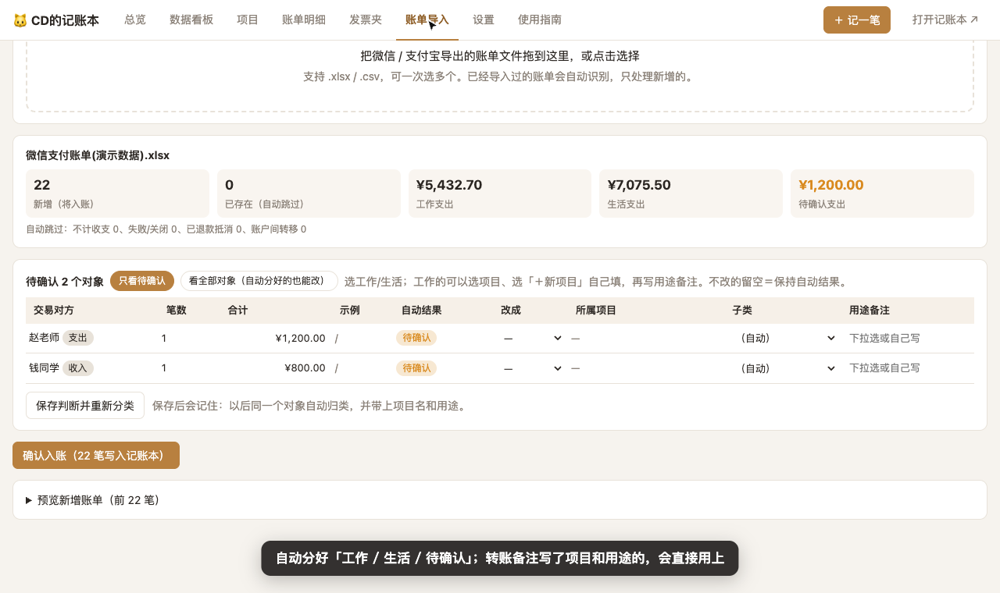
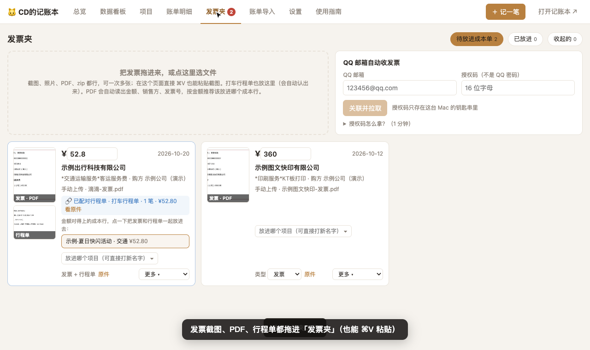
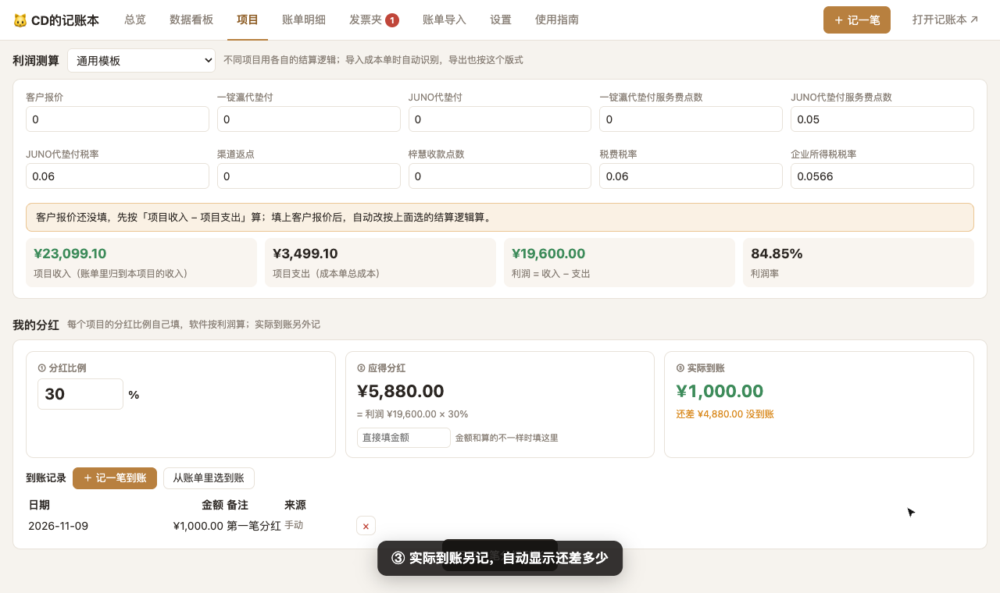
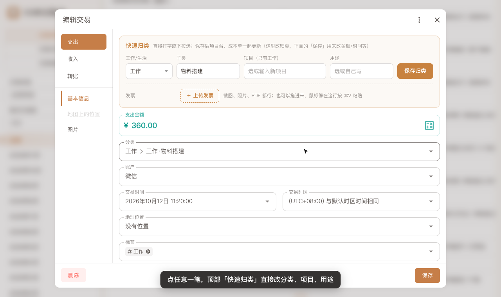
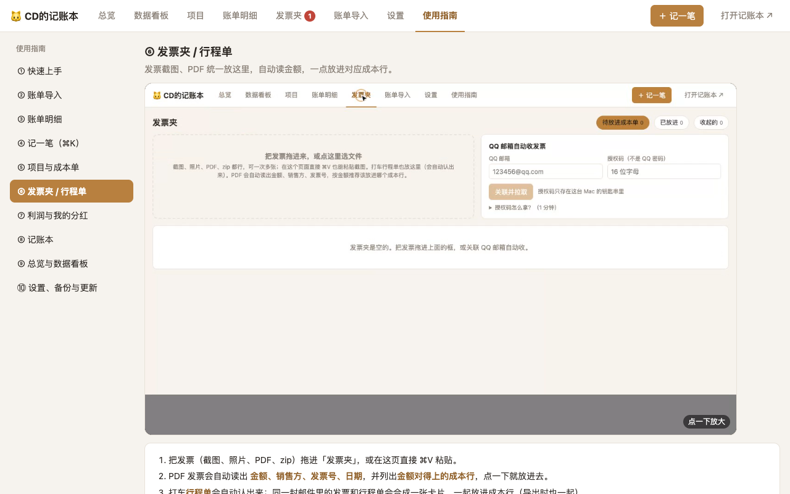

# CD的记账本

个人账 + 项目成本单，一个 Mac 软件搞定：微信/支付宝账单拖进来自动分「工作 / 生活」，项目成本单、发票、行程单、利润和分红一起管。
**所有数据只存在你自己的电脑上，不上传任何地方。**（截图均为演示数据）

## 下载安装
1. 到 [Releases](https://github.com/Dino12138/jizhangben-releases/releases/latest) 下载最新的 `JiZhangBen-版本号.dmg`。
2. 双击打开，把「CD的记账本」拖进「应用程序」。
3. 第一次打开：在「应用程序」里按住 control 点它 → 打开 → 打开（没有付费签名，系统会拦一下；或在「系统设置 → 隐私与安全性」点「仍要打开」）。
4. 只支持 Apple 芯片（M1–M4）、macOS 12 以上。

## 更新
App 开着时每 6 小时自动检查，有新版本顶部会提示：**设置 → 软件更新 → 立即更新**。
小更新只换程序（约 1 分钟，数据不动，自动重启）；大更新会下载新安装包并自动替换。国内网络连不上 GitHub 时自动走 jsDelivr 镜像。
> 1.4.0 之前的版本没有在线更新，需要手动装一次 1.4.0。

## 功能
| | |
|---|---|
|  **账单导入**：微信/支付宝账单拖进来自动分类，转账备注优先；手记的账自动合并不重复 |  **账单明细**：每一格直接改，批量改、合并重复、最近删除、导出 Excel |
|  **发票夹**：截图/PDF 自动读金额，发票和行程单自动配对，一点放进成本行；可关联 QQ 邮箱自动收 |  **利润与分红**：按结算逻辑算利润，分红比例自己填，应得和到账分开 |
|  **记账本**：完整记账软件，编辑交易时可快速归类、上传发票 |  **使用指南**：App 里每个功能都有演示视频和步骤 |

## 数据在哪 / 卸载
数据：`~/Library/Application Support/CD的记账本/`（每天自动备份到其中的「备份」）。
卸载：退出 App，删掉「应用程序」里的 CD的记账本；连数据一起删就再删上面的文件夹。

## 更新记录
- **1.4.0**（2026-11-09）：新增：使用指南（每个功能都有演示视频）、在线更新、发票夹（发票/行程单自动配对、QQ 邮箱自动收）、我的分红、上传已做好的成本单；转账备注优先归类；手记的账和账单自动合并不重复。
