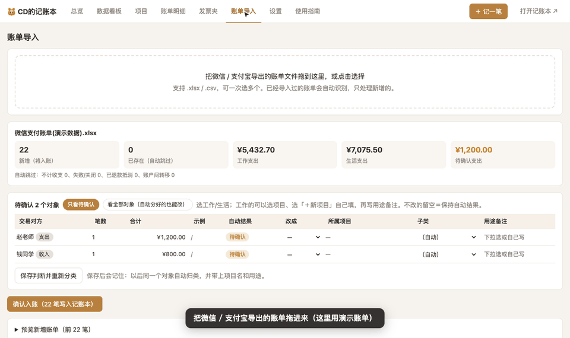
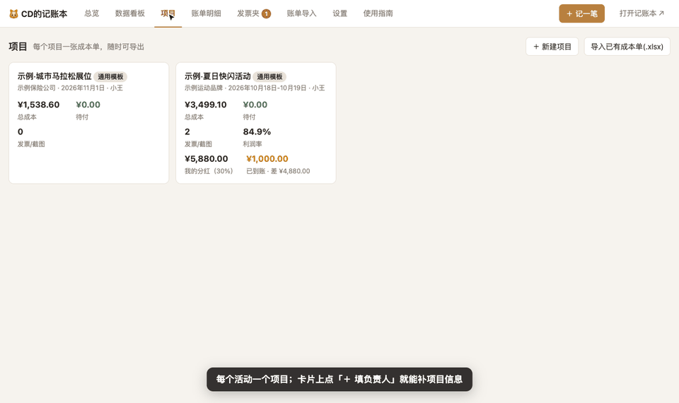
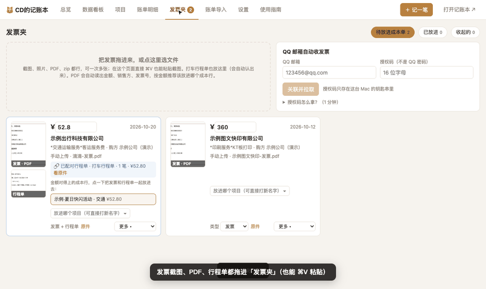
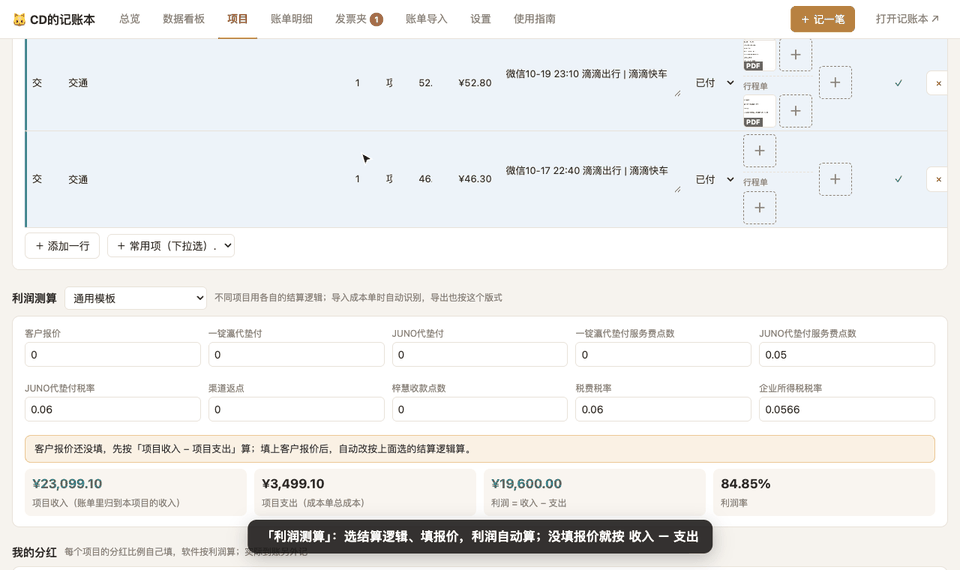

### 本次更新
__NOTES__

### 安装 / 更新
- **第一次安装**：下载下面的 `JiZhangBen-__VER__.dmg` → 双击打开 → 把「CD的记账本」拖进「应用程序」→ 在「应用程序」里**按住 control 点它 → 打开**（只需一次）。
- **已经装过**：App 顶部会提示新版本，点 **设置 → 软件更新 → 立即更新**，约 1 分钟，数据不动。
- 只支持 Apple 芯片（M1–M4）、macOS 12 及以上。所有数据只存在你自己的电脑上。

### 功能一览（演示数据）
| 账单导入 | 项目与成本单 |
|---|---|
|  |  |
| **发票夹 / 行程单 / 报销单** | **利润与我的分红** |
|  |  |

更多介绍见 [项目首页](https://github.com/Dino12138/jizhangben-releases)，App 里点顶部「使用指南」有每个功能的演示视频。

### ☕ 赞助支持
完全免费、没有广告。如果它帮你省下了时间，欢迎请我喝杯咖啡 ☕️（完全自愿）。

